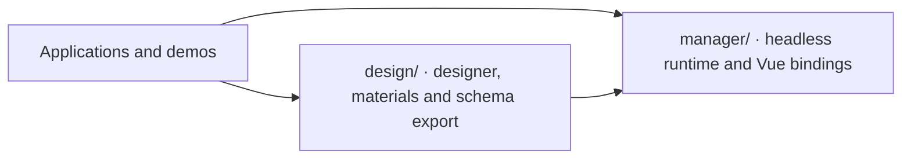

# Formivue architecture

## Package boundaries

Arrows show which layer imports the other layer.

1. **Keep the manager headless.** `manager/` owns form values, field state,
   validation, reactions and interpretation of schemas. Its Vue bindings mount
   components supplied by the application. Manager packages depend only on other
   manager packages within the workspace.
2. **Keep editing in the designer.** `design/` owns the editable tree, selection,
   history, drag and drop, property editors and visual materials. It can use the
   manager's reactivity, schema and form APIs. Keep UI components in `vue-ui`
   independent of the Formivue packages and expose their behavior through props,
   slots and events.
3. **Compose the layers in applications.** Playgrounds and examples may consume
   both package families. Libraries cannot depend on the examples. Import other
   packages by their public names and exported subpaths. Keep relative source
   imports within the owning package.
4. **Keep published package dependencies acyclic.** This includes direct,
   optional and peer dependencies. The designer playground in
   `examples/designer-playground` composes the standard stack and loads the
   advanced modules on demand. Its registries stay in the application.

## Where changes belong

| Concern                                                                                         | Package                                                        |
| ----------------------------------------------------------------------------------------------- | -------------------------------------------------------------- |
| Observable state, field paths, validation utilities                                             | `manager/reactive`, `path`, `shared`, `validator`              |
| Form and field state, effects, validation lifecycle, array mutation                             | `manager/core`                                                 |
| JSON Schema and `x-reactions` interpretation                                                    | `manager/json-schema`                                          |
| Vue lifecycle and field/component adapters                                                      | `manager/reactive-vue`, `manager/vue`                          |
| Responsive grid geometry                                                                        | `manager/grid`                                                 |
| Authoring tree, workspaces, history, selection, designer drivers                                | `design/core`, with DOM and event utilities in `design/shared` |
| Canvas, panels, drag targets, designer context and simulators                                   | `design/vue`                                                   |
| Reusable controls, layout primitives and accessibility                                          | `design/vue-ui`                                                |
| Canvas materials, `Behavior` and `Resource` metadata, settings schemas, and runtime `Materials` | `design/formivue-vue`                                          |
| Property panel and specialized editors such as data sources and reactions                       | `design/vue-settings-form`, `design/formivue-setters`          |
| Import and export of `{ form, schema }`                                                         | `design/formivue-transformer`                                  |
| Sandbox iframe and its communication                                                            | `design/vue-sandbox`                                           |

## Advanced components

- `manager/flow` implements step navigation, branching and scoped validation
  against the existing form. It has no Vue or designer dependency.
- `design/shadcn-advanced-runtime` contains Vue controls and `AdvancedMaterials`.
  It uses the headless flow package for questionnaire and stepper state.
- `design/shadcn-advanced-designer` uses the runtime and the standard designer
  to register canvas components, settings and palette resources. Applications
  can load the runtime on its own to render an exported schema.

## Chart components

- `design/charts-runtime` owns Vue chart components, Unovis rendering and
  `ChartMaterials`. It can render a chart without the designer or the advanced
  controls package.
- `design/charts-designer` owns the corresponding canvas materials, palette
  resources, property schemas and locales, following the `formivue-vue`
  layout. It depends on the chart runtime and the standard designer packages.
- Each chart has its own `x-component` key. The playground composes the chart,
  advanced and standard registries and loads the advanced palette on demand.

## The designer-to-runtime contract

1. The canvas renders a `TreeNode` using the designer's component registry.
   Settings editors write to `node.props` through the selected material's
   `propsSchema`.
2. `transformToSchema` exports `{ form, schema }`. `form` carries root layout
   props. `schema` describes fields, containers, default values, component props
   and reactions. `transformToTreeNode` rebuilds an editable tree from this
   object. Keep the object serializable and preserve stable field names and
   component keys used in saved forms.
3. At runtime, `FormProvider` supplies the `Form`. `Materials.FormLayout`
   receives the root props. `createSchemaField({ components: Materials })`
   maps the schema to fields, and the registry resolves their visual components.
   The designer preview and the **Designer form** section of `pnpm demo:playground`
   use this runtime path. Applications can also supply their own registry.

For a new material setting, update the authoring schema, its labels and the
runtime binding that consumes it. Check whether the canvas wrapper needs the
same change. Choose a default that preserves the rendering of exports created
before the setting existed. For a bug in values, validation or field identity,
fix the engine behavior in `manager/` so all renderers share the correction.

## Verification

- `pnpm lint` checks static import boundaries. The
  [workspace architecture test](./scripts/__tests__/architecture.spec.ts)
  checks declared dependencies and cycles in the published library graph.
- [The schema-flow test](./design/formivue-vue/src/__tests__/schema-flow.spec.ts)
  covers serializing an export, rendering it with `Materials`, running a reaction
  and submitting values. Layout tests should include child fields. Array tests
  should check field state after rows move or are deleted.
- `pnpm harness` runs these checks alongside the workspace builds, dependency
  analysis, type checking, tests and smoke checks used in CI.
